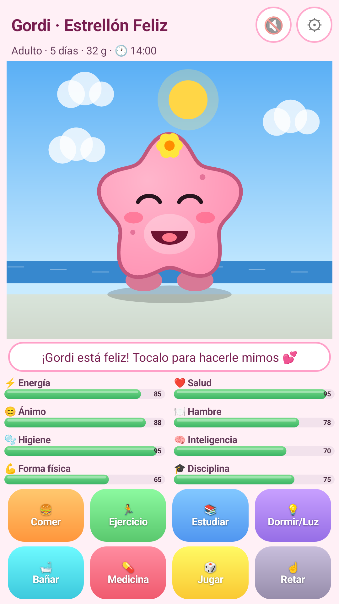
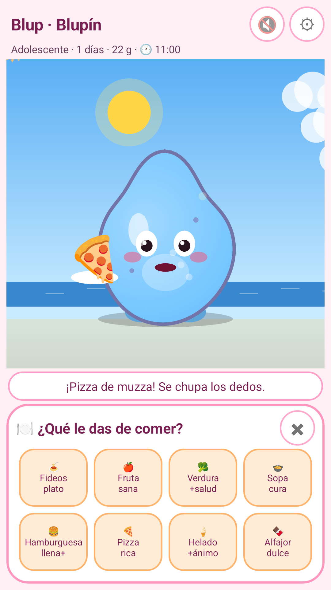

# Hola, soy Juan Ignacio (Nacho) 👋

📍 Mar del Plata, Argentina · 📧 [nachosumo@gmail.com](mailto:nachosumo@gmail.com)

Desarrollo **apps Android para celulares y Android TV / TV boxes**, con foco en automatización, control remoto entre dispositivos e **IA que corre 100 % en el equipo** (sin nube, sin cuentas).

## 🛠️ Habilidades
- **Lenguajes:** Kotlin, Java, C/C++ (JNI), Python, Bash
- **Android:** Jetpack Compose / Material 3, Android TV (Leanback, D‑pad), servicios en primer plano, accesibilidad, WorkManager, MediaProjection / AudioPlaybackCapture, cámara y streaming
- **IA local:** modelos on‑device (llama.cpp, Vosk, ML Kit), procesamiento de imagen y video
- **Automatización:** ADB por red, scripts, configuración y limpieza de TV boxes
- **Calidad:** tests JUnit / Robolectric, Gradle Kotlin DSL, builds firmados

## 📱 Proyectos
> El código fuente es privado. Esta es una vitrina de lo que hice.

| App | Qué hace | Destacado | Plataformas |
|---|---|---|---|
| **TouchPad** | Usá el celular como touchpad, mouse y teclado del TV | Emparejamiento por PIN, cursor configurable, Wi‑Fi local | Celular + Android TV |
| **CamaraIP** | Convierte un celular en cámara IP y la mirás en el TV | Descubrimiento automático, fotos y grabación de video, sin ADB ni root | Celular + Android TV |
| **VozATexto** | Transcripción en vivo de voz o del audio de otras apps | Offline, traducción en el equipo, subtítulos flotantes, exporta TXT/PDF/SRT | Celular + Android TV |
| **Gordi** | Mascota virtual estilo Tamagotchi de los 90 | Varias especies, evolución, notificaciones, partida local | Celular |
| **Consola TV** | Consola de ajustes y terminal dentro del propio TV box | Ajustes explicados en castellano, nivel de riesgo y revertir, glosario | Android TV |
| **Mesa** | Panel de ajustes, terminal y datos del equipo | Buscador de ~118 comandos con explicación | Android TV + Celular |
| **AndroidTV Control** | Control remoto y mantenimiento del TV box desde el celular | ADB por red, panel web, autolimpieza al arrancar | Celular + Android TV |
| **Nacer** | 🔒 Proyecto en desarrollo: una IA local que crece con vos | Próximamente | Celular + Android TV |
| **Retoca** | 🔒 Editor/mejorador de fotos y video con IA local | 100 % en el dispositivo · próximamente | Celular |

### 📸 Capturas — Gordi

  
  

## 📬 Contacto
¿Querés una app para tu celular o TV box? Escribime a **[nachosumo@gmail.com](mailto:nachosumo@gmail.com)**.
